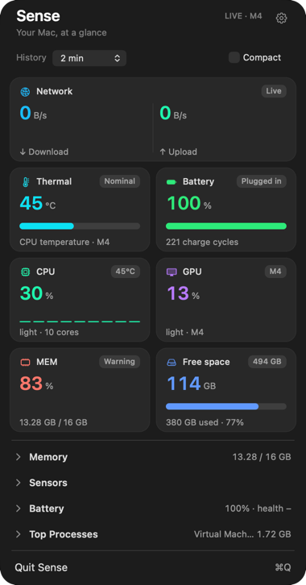
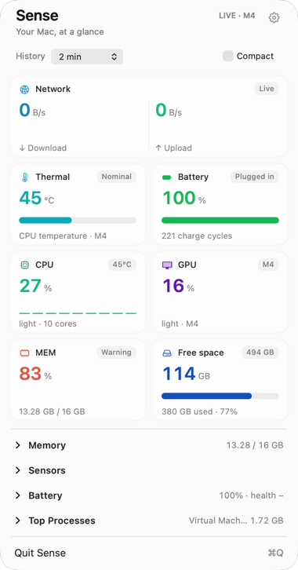

# Sense

A lightweight system monitor for the macOS menu bar, with an iPhone/iPad companion.

Live tiles for CPU, GPU, memory, free disk space, network, thermal state and battery, with sparkline history. Written in Swift/AppKit with no third-party dependencies.




## Platforms

| Platform | Location | Requirements |
| --- | --- | --- |
| macOS menu bar | `src/` | macOS 13+, universal (Apple Silicon + Intel) |
| iPhone / iPad | `iOS/` | iOS 17+, Xcode 15+ (see [iOS/README.md](iOS/README.md)) |
| Memory widget | `widget/` | macOS 13+ |

## Build (macOS)

```sh
./build.sh 1.3
```

Produces `dist/Sense-1.3.dmg`. Builds are not committed; get them from the GitHub Releases page.

## Tests

```sh
tools/test_features.sh
```
