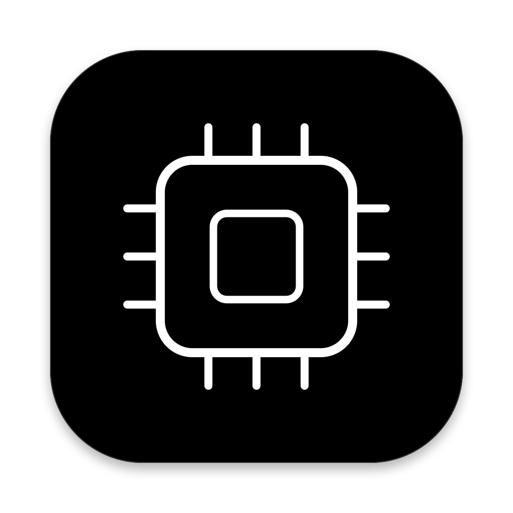

<p align="center">
  
</p>

<h1 align="center">Sense</h1>

<p align="center">
  Live system readings and recent activity charts, one click away in your Mac’s menu bar.
</p>

<p align="center">
  <a href="#install">Install</a> ·
  <a href="#use-sense">Use Sense</a> ·
  <a href="#troubleshooting">Troubleshooting</a> ·
  <a href="#build-and-test">Build and test</a>
</p>

<p align="center">
  
</p>

<p align="center">
  <a href="previews/Sense-light.png">Light dashboard</a> ·
  <a href="previews/Sense-dark.png">Dark dashboard</a> ·
  <a href="previews/Sense-settings.png">Settings</a>
</p>

<p align="center"><sub>Development preview with sample readings.</sub></p>

## Install

Sense targets **macOS 13 or later** on Apple silicon and Intel. A notarized download is in preparation. Build from source with Xcode and the macOS 26 SDK or later. [GitHub Releases](https://github.com/mohan-codebase/sense/releases)

```sh
git clone https://github.com/mohan-codebase/sense.git
cd sense
./build.sh
open dist/Sense.app
```

## Use Sense

1. Click the Sense icon in the menu bar to see CPU, GPU, memory, storage, network, temperature, and battery readings.
2. Hover over a chart to inspect a sample. Expand **Memory**, **Sensors**, **Battery**, or **Top Processes** for details.
3. Open **Settings** using the gear icon to choose a history window, rearrange cards, turn on Compact mode, or configure alerts.

Sense keeps readings and history on your Mac. The dashboard follows your system appearance and uses native Liquid Glass on macOS 26 and later.

## Troubleshooting

- **Sense doesn’t appear in the menu bar.** Open `dist/Sense.app` again and check whether the menu bar has room for the icon.
- **A reading is unavailable.** Sensor and battery support varies by Mac. Older samples appear in the charts after Sense has had time to collect them.
- **An alert doesn’t appear.** Check Sense’s alert settings and its notification permission in macOS System Settings.

## Build and test

`./build.sh` builds a universal macOS app and creates a local development DMG in `dist/`.

```sh
bash tools/test_features.sh
```
