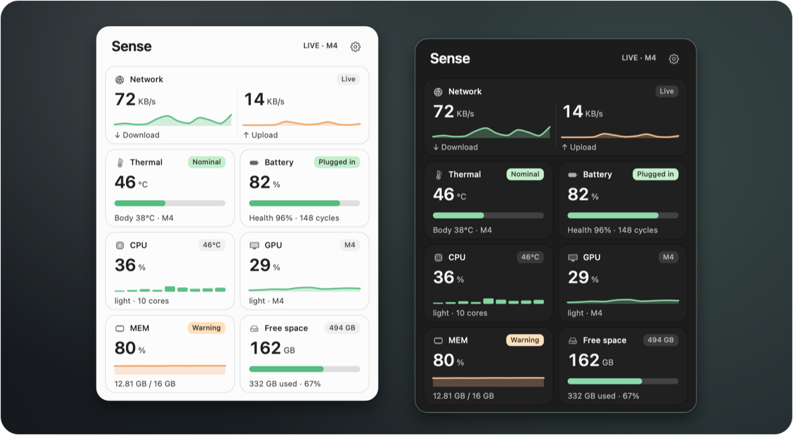
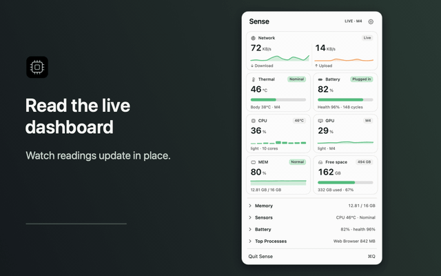
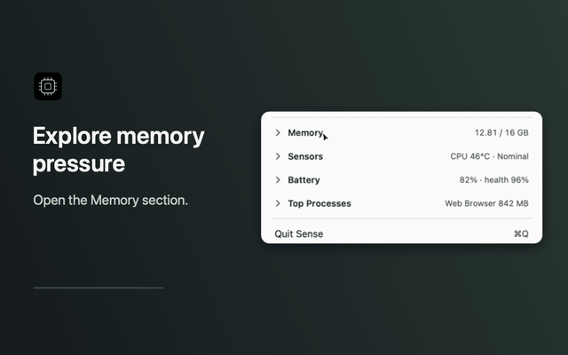
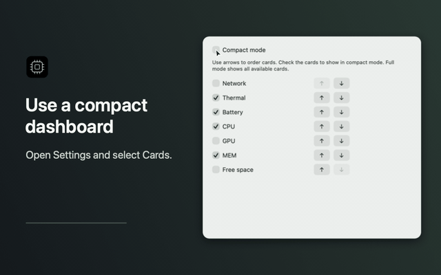

<p align="center">
  
</p>

<h1 align="center">Sense</h1>

<p align="center">
  Live system monitoring from your Mac’s menu bar.
</p>

<p align="center">
  <a href="#install">Install</a> ·
  <a href="#use-sense">Use Sense</a> ·
  <a href="#watch-the-demos">Watch the demos</a> ·
  <a href="#troubleshooting">Troubleshooting</a>
</p>

<p align="center">
  
</p>

<p align="center">
  <sub>Development preview with sample readings ·
  <a href="previews/Sense-light.png">Light mode</a> ·
  <a href="previews/Sense-dark.png">Dark mode</a></sub>
</p>

## Install

Sense targets **macOS 13 or later** on Apple silicon and Intel. A notarized download is in preparation. Build from source with Xcode and the macOS 26 SDK or later. [GitHub Releases](https://github.com/mohan-codebase/sense/releases)

```sh
git clone https://github.com/mohan-codebase/sense.git
cd sense
./build.sh
open dist/Sense.app
```

## Use Sense

1. Click the Sense icon in the menu bar to see CPU, GPU, memory, storage, network, temperature, and battery readings.
2. Hover over a chart to inspect a sample. Expand **Memory**, **Sensors**, **Battery**, or **Top Processes** for details.
3. Open **Settings** using the gear icon to choose a history window, rearrange cards, turn on Compact mode, or configure alerts. [Card settings preview](previews/Sense-settings.png)

Sense keeps readings and history on your Mac. The dashboard follows your system appearance and uses native Liquid Glass on macOS 26 and later.

## Watch the demos

Each clip is eight seconds and uses sample readings.

[](docs/media/sense-dashboard.mp4)

[Watch or download the live dashboard MP4](docs/media/sense-dashboard.mp4)

<details>
<summary>Explore memory pressure</summary>

[](docs/media/sense-memory.mp4)

[Watch or download the memory pressure MP4](docs/media/sense-memory.mp4)

</details>

<details>
<summary>Set up Compact mode</summary>

[](docs/media/sense-compact.mp4)

[Watch or download the Compact mode MP4](docs/media/sense-compact.mp4)

</details>

## Troubleshooting

- **Sense doesn’t appear in the menu bar.** Open `dist/Sense.app` again and check whether the menu bar has room for the icon.
- **A reading is unavailable.** Sensor and battery support varies by Mac. Older samples appear in the charts after Sense has had time to collect them.
- **An alert doesn’t appear.** Check Sense’s alert settings and its notification permission in macOS System Settings.

## Build and test

`./build.sh` builds a universal macOS app and creates a local development DMG in `dist/`.

```sh
bash tools/test_features.sh
```
